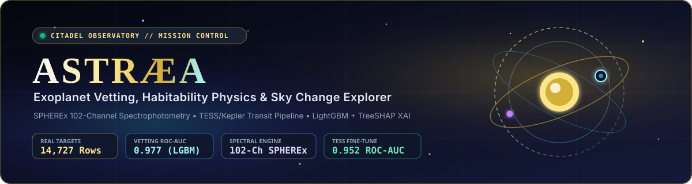
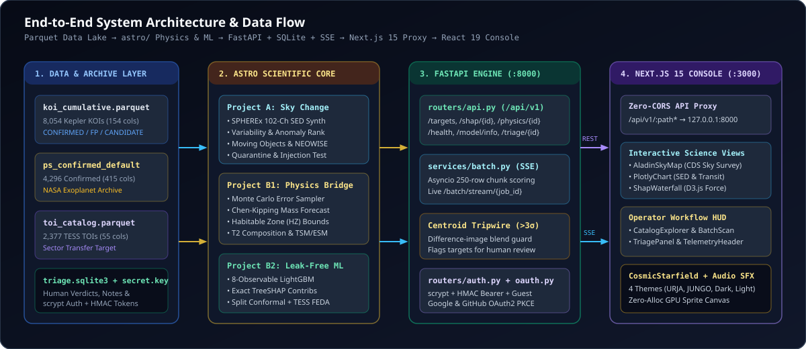
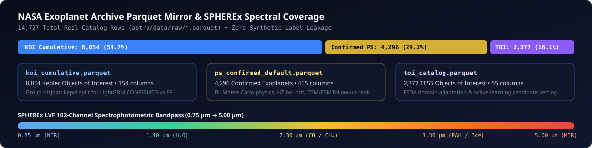

<div align="center">

<!-- Animated Deep-Space Astrolabe Header -->


<br />

<!-- Animated Typing Tagline -->
<a href="#overview">
  
</a>

<br />

<!-- Tech Stack & Metric Badges -->
<p>
  
  
  
  
  
  
  
</p>

<!-- Quick Navigation Bar -->
<p>
  <a href="#overview">Overview</a> •
  <a href="#quick-start">Quick Start</a> •
  <a href="#architecture">Architecture</a> •
  <a href="#datasets--spectral-engine">Datasets</a> •
  <a href="#dual-scientific-pipelines">Pipelines</a> •
  <a href="#ai-vetting--shap-explainability">ML &amp; SHAP</a> •
  <a href="#api-reference">API</a> •
  <a href="#visual-themes">Themes</a> •
  <a href="#testing">Testing</a>
</p>

</div>

---

## Overview

**ASTRÆA Citadel Observatory** is a full-stack astrophysics and explainable-AI mission control platform built for **exoplanet candidate vetting**, **habitability & composition modeling**, and **SPHEREx-style 102-channel sky-change anomaly detection**.

It unifies two complementary scientific pipelines behind a high-speed **FastAPI** backend and an interactive **Next.js 15 / React 19** observatory console:

- **14,727 real catalog rows** ingested from NASA Exoplanet Archive (`KOI`, `PS`) and TESS (`TOI`) Parquet tables.
- **Zero-leakage LightGBM vetting** (`0.977` KOI hold-out ROC-AUC; `0.952` TESS v4 fine-tuned ROC-AUC) with exact **TreeSHAP** per-target waterfall explanations.
- **Monte Carlo astrophysics engine** propagating stellar/orbital uncertainties through the **Chen–Kipping** mass–radius forecaster and **Kopparapu** habitable zone boundaries.
- **Real-time SSE batch scanning** in 250-row async chunks + persistent **SQLite triage verdicts**.

### Featured Demo Targets

| Target ID | Catalog / Type | Highlight |
| :--- | :--- | :--- |
| `TOI-700.02` | TESS (TOI) | Temperate Earth-sized habitable-zone candidate |
| `TOI-1452.01` | TESS (TOI) | Water-world / ocean-planet super-Earth candidate |
| `KOI-00351.01` | Kepler (KOI) | Multi-planet system (`Kepler-90`) benchmark |
| `DEMO-FUOR-01` | Project A Transient | FU Orionis-like young stellar outburst |
| `DEMO-ANOMALY-01` | Project A Anomaly | High-Mahalanobis IR-excess spectral outlier |

---

## Quick Start

<div align="center">
  
</div>

### Option 1 — One-Click Windows Launchers

```powershell
# Terminal 1: Start FastAPI backend (http://127.0.0.1:8000)
.\start-backend.bat

# Terminal 2: Start Next.js frontend (http://localhost:3000)
.\start-frontend.bat
```

### Option 2 — Manual Setup (Windows PowerShell / Linux / macOS)

<details open>
<summary><b>Step-by-step terminal commands</b></summary>

```bash
# 1. Clone the repository
git clone https://github.com/yajatkataria08-a11y/astraea-citadel-observatory.git
cd astraea-citadel-observatory

# 2. Configure & start the FastAPI backend
cd backend
cp .env.example .env
pip install -r requirements.txt
python run.py
# → API live at http://127.0.0.1:8000 (Swagger UI: /docs, Health: /health)

# 3. Configure & start the Next.js 15 frontend (in a new terminal)
cd ../frontend
cp .env.example .env.local
npm install
npm run dev
# → Observatory UI live at http://localhost:3000
```

</details>

> **Demo Credentials:** Email `test@example.com` · Password `password123`

---

## Architecture

<div align="center">
  
</div>

ASTRÆA is organized into four cleanly decoupled layers:

1. **Data Lake (`astro/data/raw/` & `backend/data/`)**: Columnar Parquet catalogs (`14,727` targets) and SQLite triage/auth persistence.
2. **Scientific Core (`astro/src/`)**: Pure Python/NumPy/SciPy/LightGBM modules for Project A (sky change) and Project B (`b1_physics` + `b2_vetting`).
3. **FastAPI Engine (`backend/app/`)**: Async REST + SSE streaming server (`http://127.0.0.1:8000`) bridging `astro/` via `astro_bridge.py`.
4. **Next.js 15 Console (`frontend/src/`)**: Interactive App Router UI featuring `CosmicStarfield`, `AladinSkyMap`, `CatalogExplorer`, `ShapWaterfall`, `BatchScanModal`, `PlotlyChart`, and `TriagePanel`.

---

## Datasets & Spectral Engine

<div align="center">
  
</div>

| Parquet File | Rows | Columns | Size | Role |
| :--- | ---: | ---: | ---: | :--- |
| `koi_cumulative.parquet` | 8,054 | 154 | 3.32 MB | Kepler Objects of Interest — primary LightGBM training & hold-out |
| `ps_confirmed_default.parquet` | 4,296 | 415 | 1.91 MB | NASA Confirmed Planetary Systems — mass-radius & HZ priors |
| `toi_catalog.parquet` | 2,377 | 55 | 0.60 MB | TESS Objects of Interest — cross-mission fine-tuning (`v4`) |
| **Total** | **14,727** | **—** | **5.83 MB** | **100% real NASA/TESS catalog data** |

- **SPHEREx 102-Channel Synthesizer**: Generates 102-channel spectrophotometric SEDs across **0.75–5.00 µm** (Bands 1–6) for transient & IR-excess analysis.
- **Mandel–Agol Transit Curves & Centroid Tripwire**: Synthesizes limb-darkened transit light curves and checks odd/even depth + centroid offsets.

---

## Dual Scientific Pipelines

<div align="center">
  
</div>

### Project A — SPHEREx Sky Change Explorer
1. **NEOWISE & Multi-Epoch Crosswalk**: Ingests 102-channel SEDs (`0.75–5.00 µm`) with moving-object quarantine.
2. **Variability & Spectral Typing**: Identifies FU Orionis outbursts, dippers, YSOs, and IR-excess templates.
3. **Anomaly Scoring & Injection Recovery**: Ranks outliers and validates completeness with synthetic signal injection.
4. **SHAP Ranker & Triage Queue**: Surfaces prioritized transient alerts (`DEMO-FUOR-01`, `DEMO-ANOMALY-01`).

### Project B — Habitability (`B1`) & ML Vetting (`B2`)
- **B1 Astrophysics (`astro_bridge.py` / `b1_physics/`)**: Monte Carlo uncertainty sampling → Chen–Kipping mass–radius forecasting → Kopparapu conservative & optimistic habitable zone evaluation.
- **B2 ML Vetting (`vetting.py` / `b2_vetting/`)**: Leak-free 8-feature LightGBM classifier + TreeSHAP waterfall + centroid/transit tripwire.

---

## AI Vetting & SHAP Explainability

<div align="center">
  
</div>

### Model Metrics

| Metric | KOI LightGBM | TESS v4 Fine-Tuned |
| :--- | :---: | :---: |
| **ROC-AUC** | **0.977** | **0.952** |
| **PR-AUC** | — | **0.907** |
| **Accuracy** | — | **0.902** (90.2%) |
| **F1 Score** | — | **0.864** |
| **Brier Score** | — | **0.079** |

### Leak-Free 8-Feature Set

| Feature | Display Name | Units | Role in Model |
| :--- | :--- | :--- | :--- |
| `period` | Orbital Period | days | Transit cadence & dynamical stability |
| `duration` | Transit Duration | hours | Stellar density & impact parameter proxy |
| `depth` | Transit Depth | ppm | Planet-to-star radius ratio $(R_p / R_*)^2$ |
| `prad` | Planet Radius | $R_\oplus$ | Physical size regime (Earth / Sub-Neptune / Giant) |
| `srad` | Stellar Radius | $R_\odot$ | Host star scale & dilution check |
| `steff` | Stellar Effective Temp | K | Host spectral type & luminosity |
| `slogg` | Stellar Surface Gravity | $\log_{10}(\text{cm/s}^2)$ | Dwarf vs. giant star discrimination |
| `snr` | Transit Signal-to-Noise | $\sigma$ | Detection statistical significance |

---

## API Reference

<div align="center">
  
</div>

Base URL: `http://127.0.0.1:8000` · Interactive Swagger Docs: `/docs` · ReDoc: `/redoc`

<details>
<summary><b>All 11 Science Endpoints &amp; 6 Auth Endpoints</b></summary>

#### Science Endpoints (`backend/app/routers/api.py`)
| Method | Endpoint | Description |
| :--- | :--- | :--- |
| `GET` | `/health` | Service health & catalog readiness check |
| `GET` | `/model/info` | LightGBM model version, features, and metrics |
| `GET` | `/targets` | Paginated, filterable catalog explorer |
| `GET` | `/targets/featured` | Curated demo targets (`TOI-700.02`, `KOI-00351.01`, etc.) |
| `GET` | `/targets/{id}` | Full target telemetry, transit curve & vetting score |
| `GET` | `/shap/{id}` | Exact TreeSHAP waterfall feature contributions |
| `GET` | `/physics/{id}` | Monte Carlo HZ, insolation, $T_{eq}$, & Chen–Kipping mass |
| `POST` | `/triage/{id}/verdict` | Persist analyst triage verdict to SQLite |
| `POST` | `/batch/scan` | Launch asynchronous 250-row chunked batch scan |
| `GET` | `/batch/stream/{id}` | Server-Sent Events (SSE) real-time progress stream |
| `GET` | `/batch/{id}` | Poll batch job status & summary |

#### Authentication Endpoints (`backend/app/routers/auth.py`)
| Method | Endpoint | Description |
| :--- | :--- | :--- |
| `POST` | `/auth/signup` | Register user with `scrypt` salted password hash |
| `POST` | `/auth/login` | Authenticate & receive HMAC-SHA256 bearer token |
| `GET` | `/auth/me` | Fetch authenticated user profile |
| `GET` | `/auth/oauth/{provider}/start` | Initiate OAuth2 PKCE flow (`google`, `github`, `microsoft`) |
| `GET` | `/auth/oauth/{provider}/callback` | Exchange OAuth2 code for session token |
| `DELETE` | `/auth/logout` | Revoke active session token |

</details>

---

## Visual Themes

<div align="center">
  
</div>

Switch seamlessly between **4 observatory themes** via `/settings` (persisted in `localStorage` with automatic system-preference detection):
- **⚡ URJA** — Golden Solar light palette (`#FAF8F5` / `#C59B27` / `#11162B`)
- **✦ JUNGO** — Deep Space Void dark palette (`#090A0F` / `#D4AF37` / `#A5F3FC`)
- **🌙 DARK** — High-Contrast Obsidian
- **☀️ LIGHT** — Starlight Marble

---

## Authentication

- **Password Security**: `scrypt` salted hashing (`backend/app/services/auth.py`).
- **Session Tokens**: `HMAC-SHA256` signed bearer tokens with configurable `TOKEN_TTL_SECONDS`.
- **OAuth2 PKCE**: Built-in support for **Google**, **GitHub**, and **Microsoft** (see [OAUTH_SETUP.md](OAUTH_SETUP.md)).
- **Security Hygiene**: `backend/.env` and `secret.key` are gitignored; copy `backend/.env.example` for local setup.

---

## Testing

```bash
# Run backend API & service tests (15/15)
cd backend
python -m pytest tests

# Run astro scientific pipeline & ML tests
cd ../astro
python -m pytest tests
```

---

## Project Structure

<details>
<summary><b>Click to expand repository tree</b></summary>

```text
ASTRAEA2/
├── astro/
│   ├── checkpoints/          # Model metrics JSONs (v1–v4)
│   ├── config/settings.yaml  # Pipeline configuration
│   ├── data/raw/             # KOI, PS, TOI Parquet catalogs (14,727 rows)
│   ├── src/
│   │   ├── common/           # Crosswalk, splitting, inference, archive ingest
│   │   ├── project_a/        # SPHEREx sky-change, anomaly, NEOWISE, spectral typing
│   │   └── project_b/
│   │       ├── b1_physics/   # Sampler, Chen-Kipping, Kopparapu HZ, composition
│   │       └── b2_vetting/   # LightGBM, TreeSHAP, TESS fine-tuning
│   └── tests/                # Scientific pipeline & benchmark tests
├── backend/
│   ├── app/
│   │   ├── routers/          # api.py (11 endpoints), auth.py (6 endpoints)
│   │   ├── services/         # vetting, catalog, batch (SSE), triage, auth, oauth
│   │   └── astro_bridge.py   # Bridge to astro/ physics & ML core
│   ├── tests/                # FastAPI integration tests
│   ├── .env.example          # Environment template
│   └── run.py                # Uvicorn launcher
├── docs/assets/              # 9 animated SVG infographics, banner & footer
├── frontend/
│   ├── src/
│   │   ├── app/              # Next.js 15 App Router pages
│   │   └── components/       # CosmicStarfield, AladinSkyMap, ShapWaterfall, etc.
│   └── .env.example          # Frontend env template
├── OAUTH_SETUP.md            # OAuth2 PKCE provider setup guide
├── pipeline.md               # Detailed scientific pipeline specification
├── start-backend.bat/.sh     # One-click backend launchers
└── start-frontend.bat/.sh    # One-click frontend launchers
```

</details>

---

<div align="center">
  
</div>
